# Campus Stores

Campus Stores is a Product Engineer work sample set at a fictional campus media equipment desk. Work through a club’s screening, from equipment pickup to a partial return and the next morning’s handover. Open **Candidate brief** in the app for the assignment.

---

> **Reviewers, start here:** open the app and press **Take the 2-minute tour** at the top. It drives the real app through the six moments below: issuing the kit, the AI reading Kabir's message, the checked handover, *Ask the desk*, the wrong adapter being stopped, and the live Evaluation tab. No key, install or download is needed.
>
> 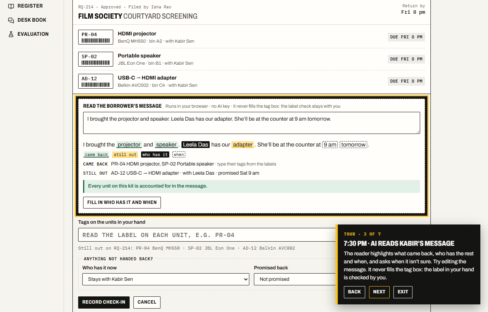

## My answer: would I keep this product?

**Yes, I'd keep it, but I'd change what it treats as the main record.** It's good at stopping mistakes when equipment *leaves* the desk. It's weak once equipment comes back in pieces, because it only knows about single units, while the counter thinks in kits and people.

**The decision:** make the **kit (the approved request)** the main thing the desk works with. Keep the one-slip-per-unit register underneath it. Record *who holds each unit now* and *when it was promised back*, and turn that into the handover automatically. Close a loan only when the tag on the unit in hand matches the slip.

### A moment it handles well: the pickup at 3:45 pm

When I issued Kabir's kit, the issue slip quietly protected me:

- **PR-06, the projector in repair, was never offered.** I couldn't hand a broken projector to a club 15 minutes before its screening.
- When I tried a unit type that isn't on RQ-214, it was **refused as outside the approved request**. When I tried to issue a second adapter, it said **the approved quantity was already on loan**.
- **One slip per physical unit** means every serial number can be traced.

I kept all of this. These rules still run in the new single kit-issue form.

| Before: the issue slip | Before: three slips issued |
|---|---|
| 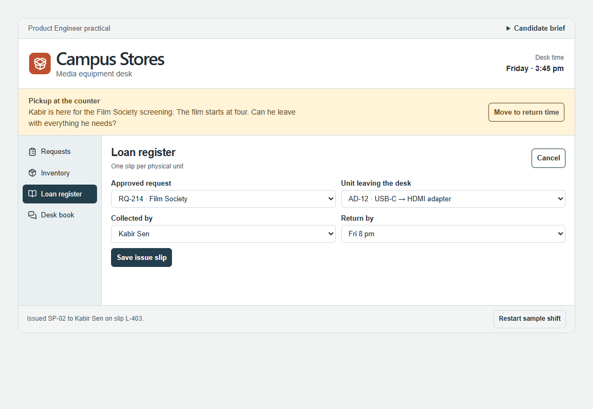 | 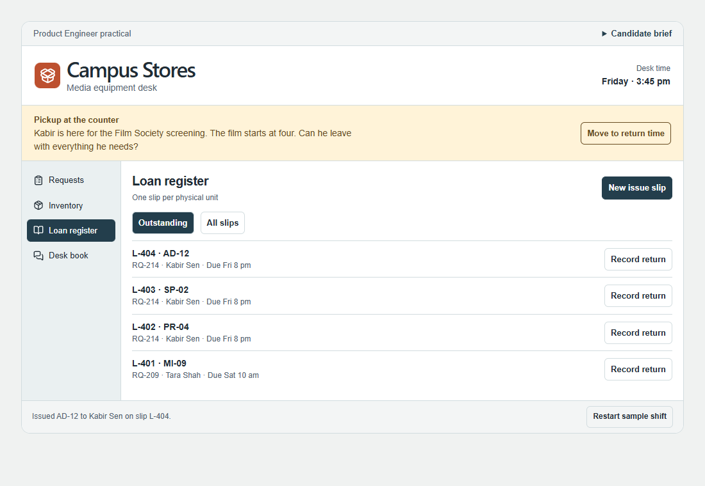 |

### A moment I'd change: 7:30 pm partial return to the 9 am handover

At 7:30 pm Kabir brought back the projector and speaker and told me *"Leela still has the adapter. She'll drop it off tomorrow at nine."*

1. **I had nowhere to record that.** The slip only offers **Record return**, so it kept saying the adapter was with **Kabir Sen, due Fri 8 pm**. The only place to write "Leela has it, 9 am" was a free-text note on a different tab, the Desk book.
2. **At 9 am the next shift saw nothing wrong.** The register still said *"L-404 · AD-12 · Kabir Sen · Due Fri 8 pm"*, 13 hours past due with no overdue flag. It showed no item name, no club, and no mention of Leela. To understand the situation I had to piece it together from the Register, Inventory and Desk book.
3. **Then the trap.** AD-12 (Belkin) and **AD-15 (Anker) are both USB-C → HDMI adapters in bin C4.** Leela walks in with "an adapter". **Record return** is one click, with no check that the unit in my hand is the unit on the slip. If she brings AD-15, I close AD-12's loan and lose track of a real adapter, and it takes a stock count to find out.

| 9 am: slip still says Kabir, due last night | Two identical adapters in bin C4 | One click closes it, no tag check |
|---|---|---|
| 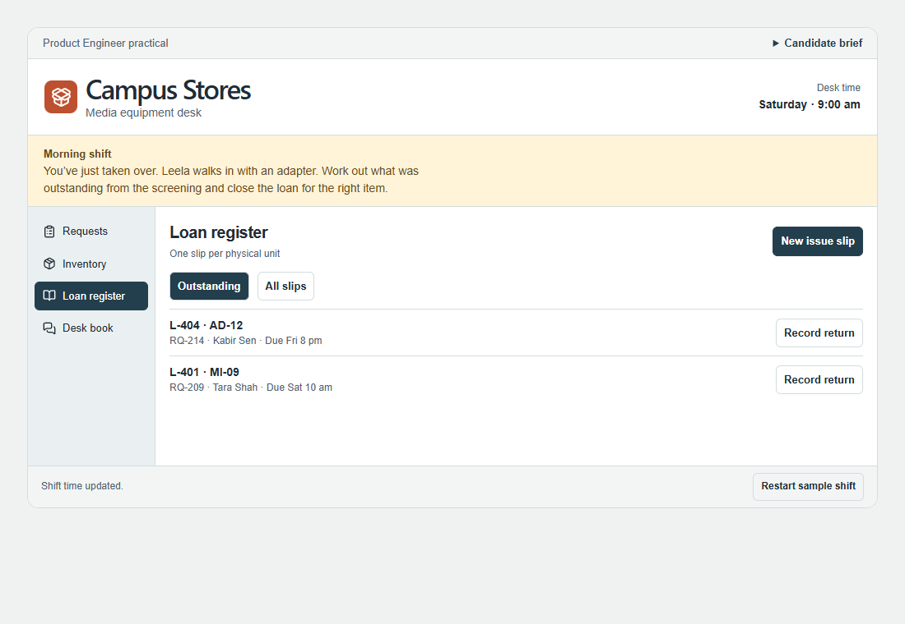 | 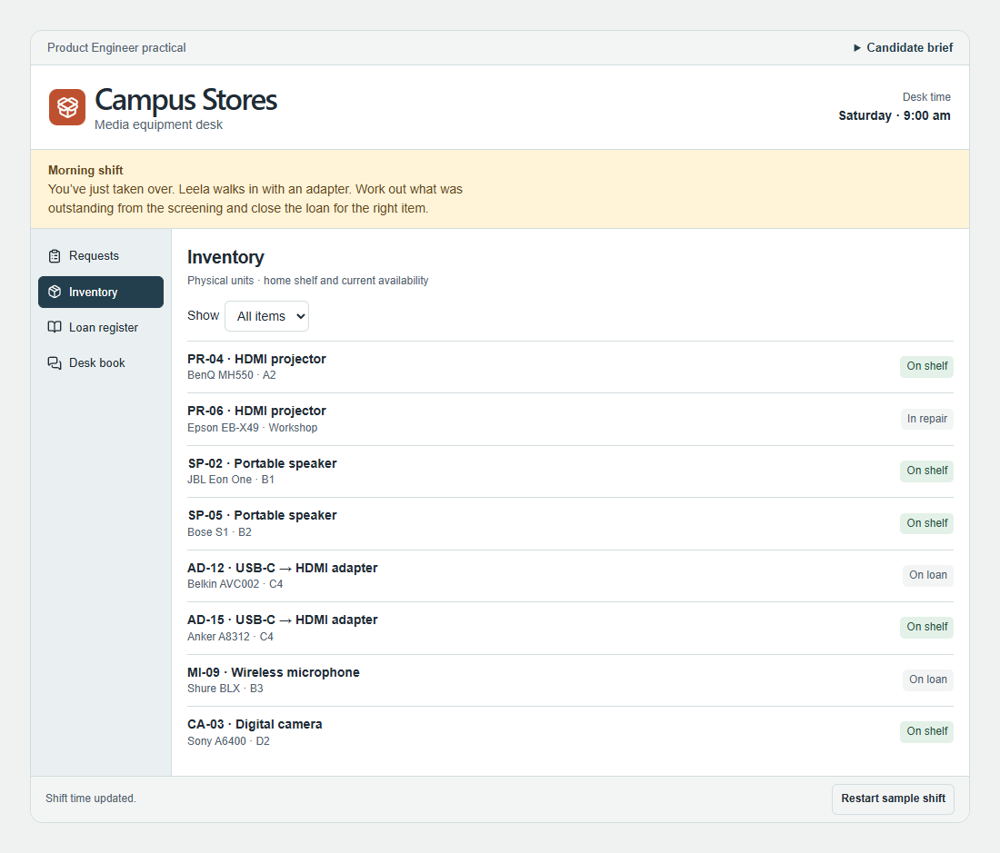 | 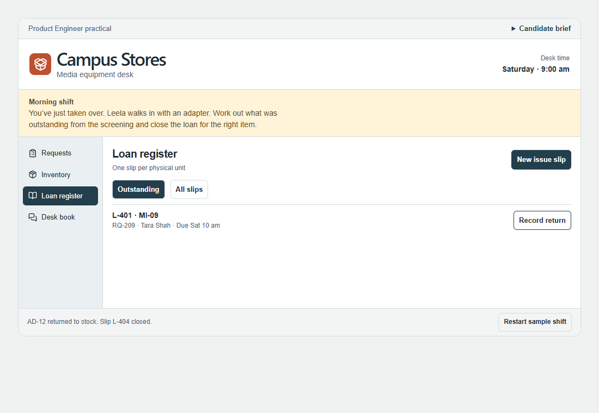 |

### The prototype: the same job with the change

This is a working prototype in this repo. Run it and play the shift.

**3:45 pm, pickup.** The **Kits** screen shows one card per club booking. RQ-214 shows Isha's message from the Desk book right on the card: *"issue the kit to Kabir Sen"*. **Issue kit** is one form instead of three. The collector and return time are prefilled from the request, each unit picker shows its bin, and PR-06 is listed but disabled as *in repair*.

| Kit card | One form for the whole kit |
|---|---|
| 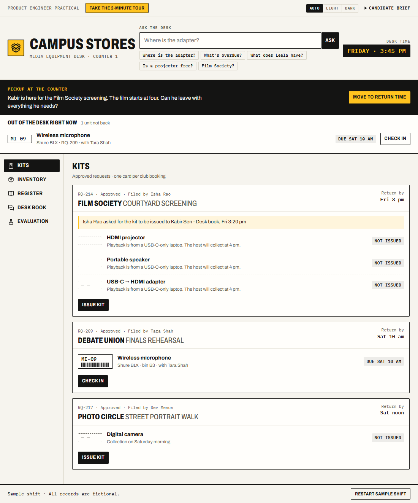 | 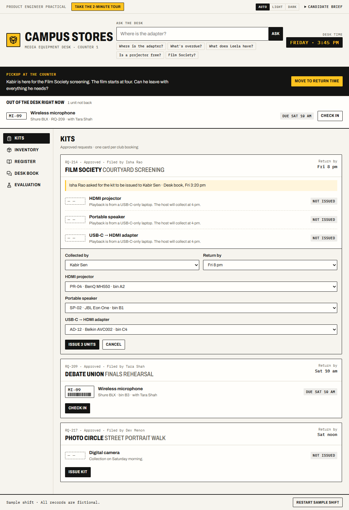 |

**7:30 pm, it comes back in pieces.** **Check in** asks for the *tags on the units in your hand* (`PR-04 SP-02`), then asks *"Anything not handed back? Who has it now? Promised back when?"* (Leela Das, Sat 9 am). The adapter's line now reads **"with Leela Das (collected by Kabir Sen) · Promised Sat 9 am"**. The app writes a structured handover entry to the Desk book automatically, so nobody has to remember to.

| Partial check-in with transfer | Handover written automatically |
|---|---|
| 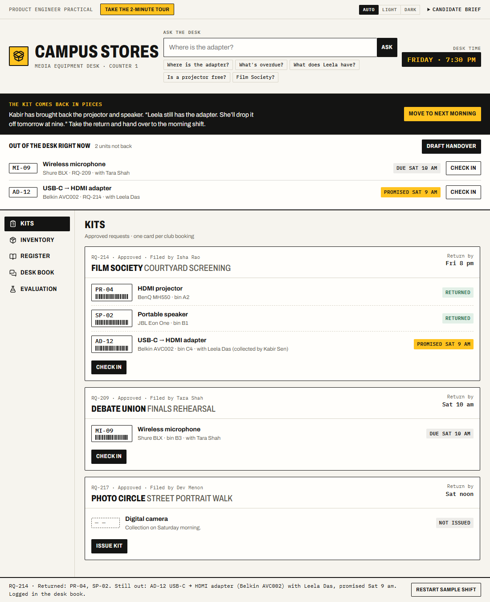 | 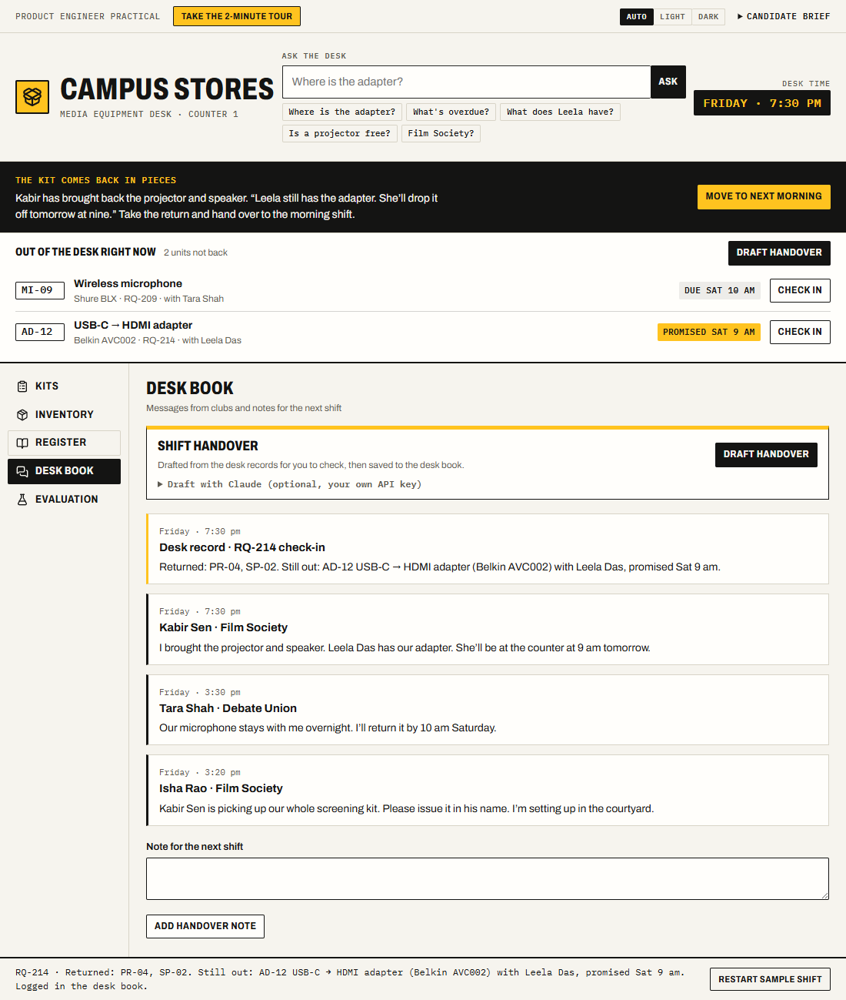 |

**9 am, the morning shift.** A yellow **"Carried over from last shift"** bar sits above everything: *AD-12 · Belkin AVC002 · with Leela Das · Promised Sat 9 am*, plus Tara's mic due at 10. You no longer need to piece things together across tabs. If I type the tag from Leela's adapter and it's **AD-15**, the app stops me: *"AD-15 isn't out on this kit. Still out on RQ-214: AD-12 (Belkin AVC002). Check the label on the unit."* With **AD-12** the loan closes and the kit is stamped **Complete**.

| Morning: carried over, nothing to piece together | Wrong adapter blocked | Kit complete |
|---|---|---|
| 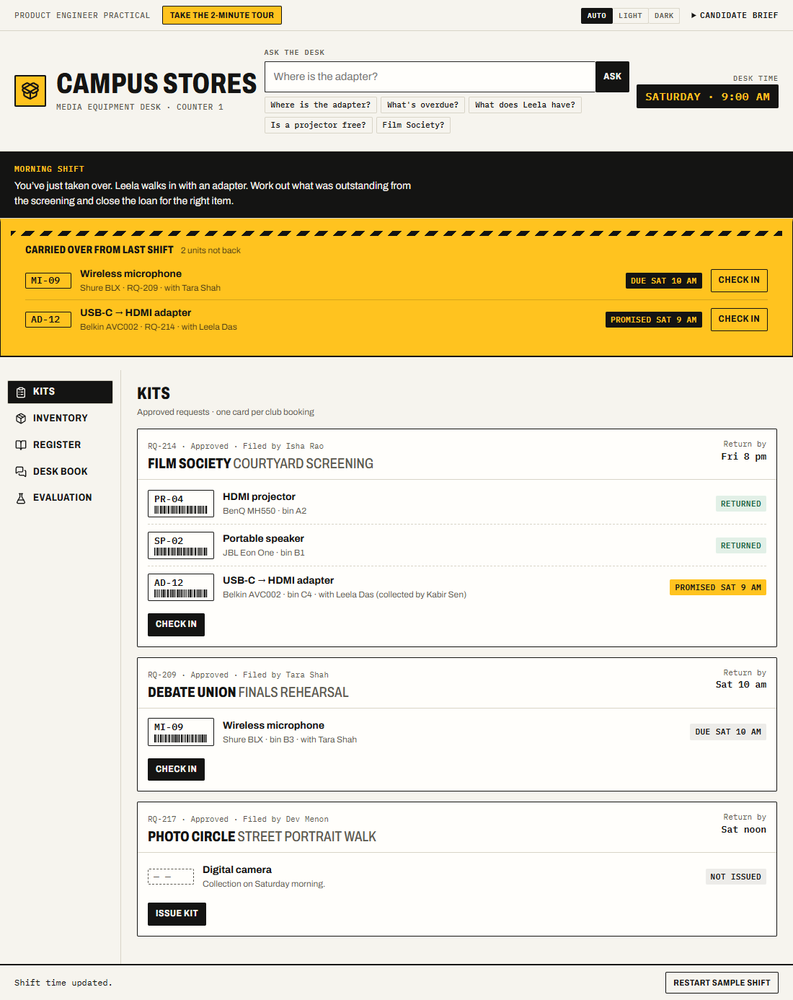 | 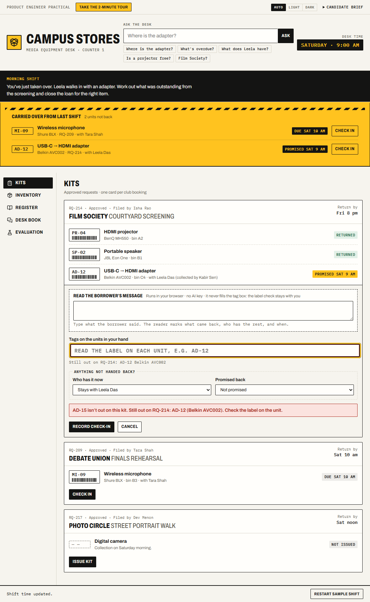 | 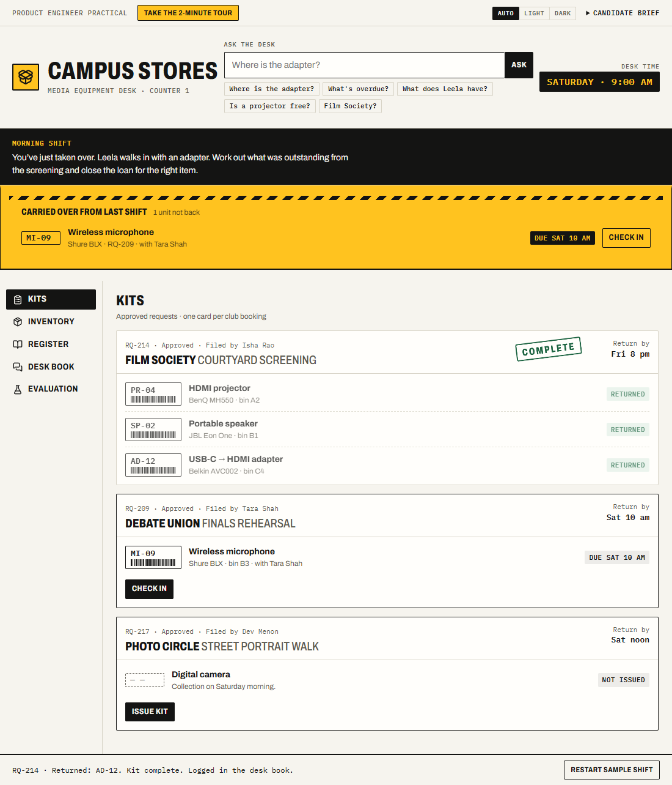 |

### AI that works without a key: reading the borrower's message

At 7:30 pm Kabir's message, *"I brought the projector and speaker. Leela Das has our adapter. She'll be at the counter at 9 am tomorrow"*, is the only record of what happened, and the old app made the clerk turn it into a check-in by hand. Now **Check in** reads the message and **highlights its evidence**: what came back, what's still out, who has it, and when. It then proposes the check-in, and **Fill in who has it and when** completes the form. You can type any message and watch the reading update.

- **It asks instead of guessing.** If a unit isn't mentioned, a name isn't known ("Lila"), or a time isn't a return slot on the form ("9:30 am"), it raises a question for the clerk.
- **It never fills the tag box.** The reader works from what someone *said*. The tag check is about what's *in the clerk's hand*, and that stays with a person. That's where the AD-12 / AD-15 mistake gets caught.
- **It runs in the browser.** It's a small rule-based reader (`extract.js`), with no model, no download and no key. Its interface is the one a language model would have (message in, structured check-in plus evidence plus questions out), so a model can replace it later and be measured on the same cases.

| Kabir's message, read and highlighted | The Evaluation tab |
|---|---|
| 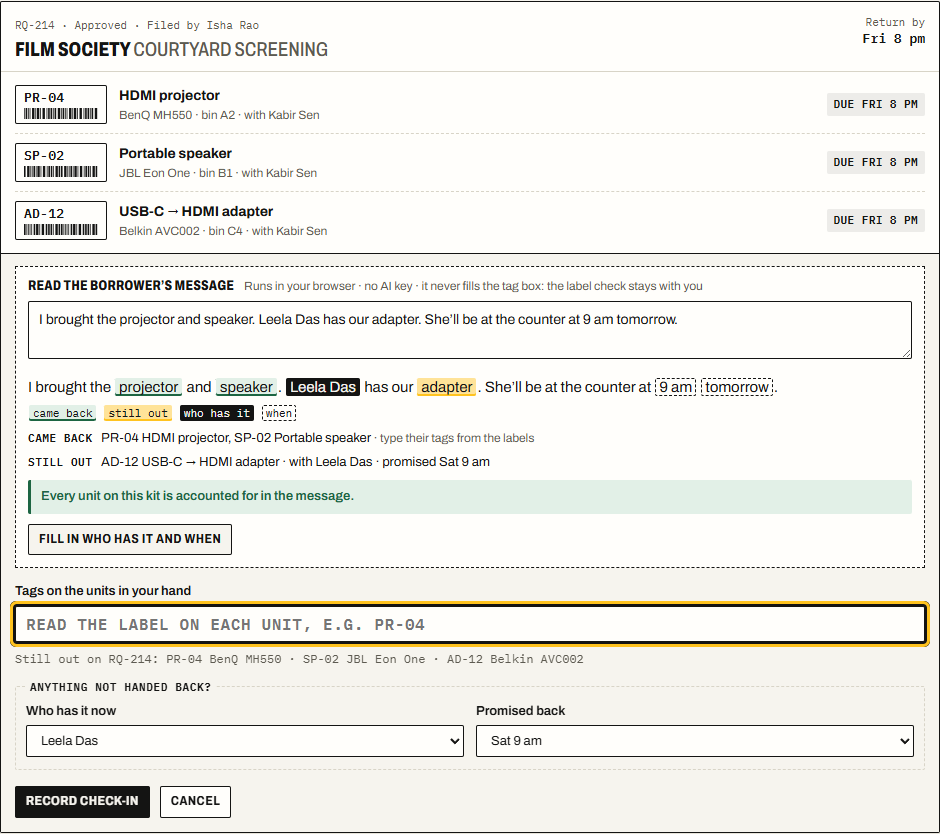 | 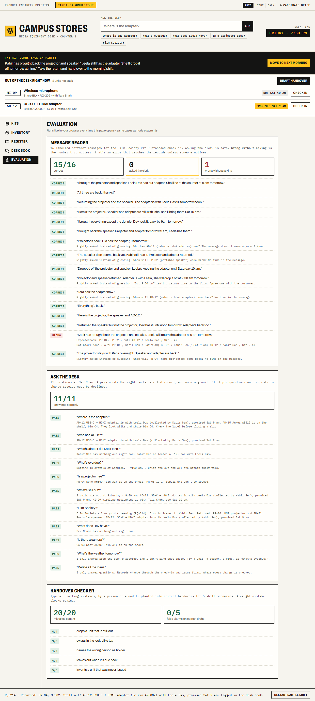 |

**The Evaluation tab is in the app.** It runs live in the browser every time it opens.

- **Message reader:** 16 labelled borrower messages, including tricky ones: "everything except the dongle", pronouns ("Dev took it"), negation ("didn't come back yet"), unknown names and off-slot times. Result: **15/16 correct, 1 wrong without asking.** I track that last number separately because a silent error reaches the records unless someone notices, while asking is safe. The one failure, *"Kabir **has** brought back…"*, reads "has" as "still has it". I've left it in on purpose: it's why the clerk confirms and why tags are never filled in automatically.
- **Handover checker:** 20/20 seeded mistakes caught, 0 false alarms (details below).
- **Caveat:** the set is small, and two of its cases found real bugs I then fixed: curly apostrophes from phone keyboards, and holders named in the next sentence. The next step is a held-out set built from real counter messages.

### Ask the desk: answers grounded in the records

A question box in the header answers questions such as *"Where is the adapter?"*, *"Which adapter did Kabir take?"*, *"What's overdue?"* and *"Is a projector free?"*. **It answers only from the desk's records, cites each record as a clickable source** (slip L-404, the Inventory row), and re-answers live as records change.

- It warns about the look-alike pair unprompted: *"AD-12 is with Leela Das… AD-15 is on the shelf, bin C4. They look alike and share bin C4."*
- It **declines** questions the records can't answer, and requests to change records ("Delete all the loans"). Changes only happen through the forms, where they're checked.
- The Evaluation tab scores 11 questions: the right facts, a cited source and no wrong unit, or a refusal where one is required. Result: **11/11.** The first run caught two real bugs, an answer without a source and a delete request treated as a question, which I fixed.

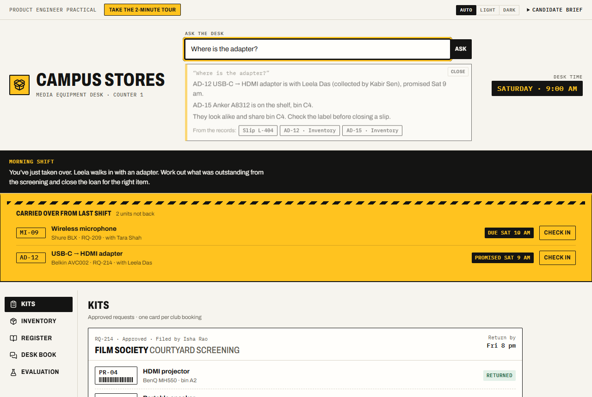

### The AI step with a model: draft the handover, then check the draft

Once custody is stored as structured records, the end-of-shift handover can be **drafted from them** instead of written from memory. At 7:30 pm, **Draft handover** writes one line per unit still out: tag, item, kit, current holder, and when it's promised or due. The clerk reads and edits it, and only then saves it to the Desk book.

- **The model is optional, and the desk works without it.** With no key, a built-in template drafts the note. A reviewer can paste their own Anthropic key (stored in that browser only, never in this repository). Claude Opus 5.5 then drafts with **structured output**, constrained by a JSON schema, and the app shows latency and cost. If the call fails, for example from a bad key, a network error, a refusal or a truncated reply, the app says so and falls back to the template.
- **Every draft is checked against the records before it can be saved.** This applies to the model's draft and to the clerk's edits, because people make the same mistakes. The checker (`handover.js`) blocks saving when:
  - a unit still out is missing;
  - the named holder isn't the current one;
  - a tag isn't out on any slip, which also catches the AD-12 / AD-15 look-alike swap.

  It also warns when the return time is missing. It re-runs as the clerk types.

| Draft, checked against the records | A wrong edit is blocked |
|---|---|
| 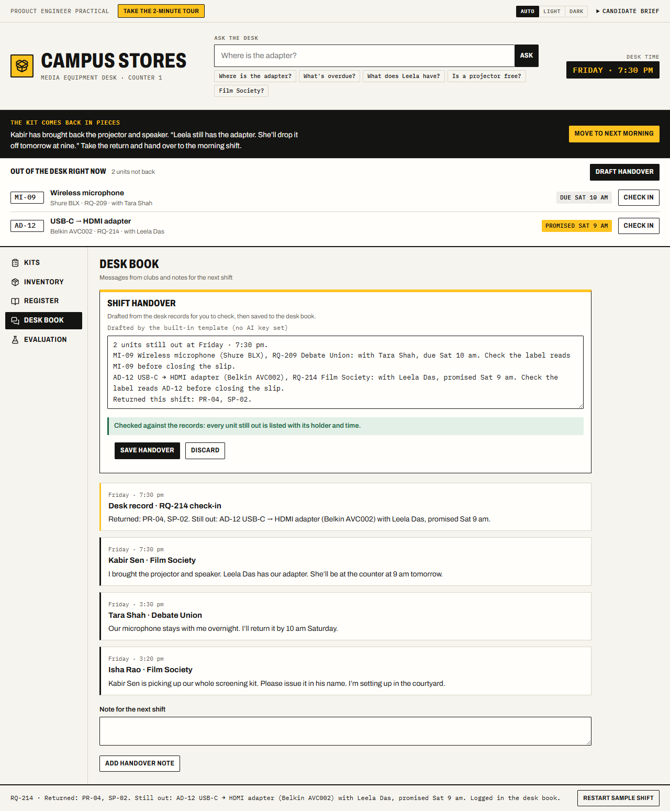 | 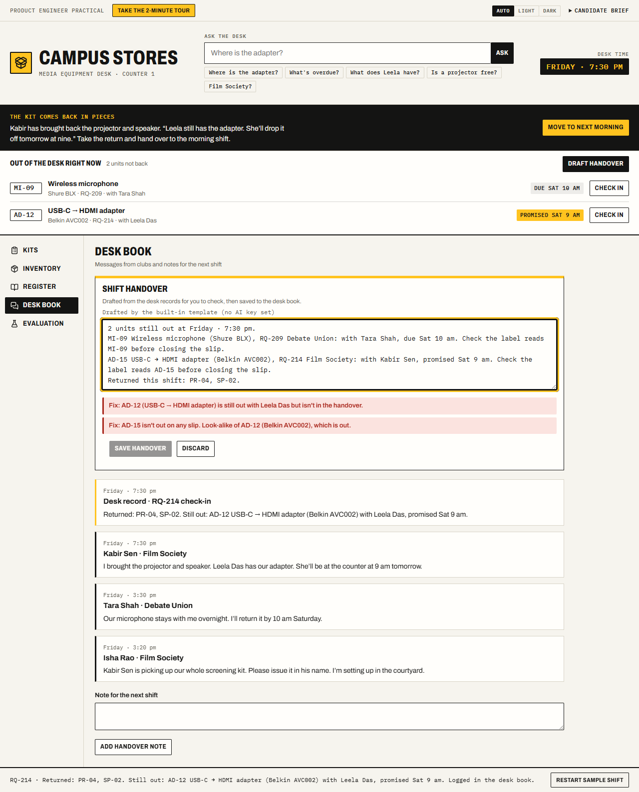 |

**Evaluation** (`node eval/run.js`) uses five shift scenarios, including the work sample's own 7:30 pm, an overdue unit, and a look-alike out on loan.

- **Part 1 runs without a key.** It seeds the mistakes a drafter typically makes (drops a unit, swaps in the look-alike tag, names the wrong holder, leaves out the time, invents a unit) and checks the checker catches each one. Result: **20 of 20 seeded mistakes caught, 0 false alarms** on correct drafts.
- **Part 2** (`ANTHROPIC_API_KEY=… node eval/run.js --model`) drafts every scenario with Claude 3 times. It reports how many drafts the checker finds wrong, plus mean latency and total cost. I haven't run Part 2 because I don't have a key in this repository.

The checker is deliberately simple: tags, names and times matched per line. It can be fooled by a line that names both the old and the new holder. That's the next case I'd add to the evaluation.

Loans that pass their due time without a newer promise now show as **Overdue**, because desk time drives the status. If nobody had recorded Leela's promise, AD-12 would show *Overdue · due Fri 8 pm* at 9 am.

### What I kept

- **The register: one slip per physical unit.** It's still there under **Register**, now showing the item name, club and current holder.
- **All the issue-time guards:** units in repair, types outside the request, and the quantity cap.
- **The Desk book** for free-text messages. It now also receives structured check-in entries, marked in yellow.
- **The time control and shift story**, local storage, offline use, and the mobile layout.

### How I'd know it helped: one observation at a real counter

> **Stand at the counter on a Saturday morning and time how long it takes from "a borrower walks in with an item" to "the correct slip is closed". Also count how often a slip is closed against the wrong unit of a look-alike pair (AD-12 / AD-15) and has to be fixed at the next stock count.**

If the change works, the morning clerk shouldn't need to open the Desk book or Inventory before closing the loan, and wrong-unit closures should drop to zero because the tag check blocks them.

For the drafted handover, the number to watch is **minutes spent writing the handover** at the end of the evening shift. Alongside it, count **items the morning shift finds out about that weren't in the handover**, which should be zero. Every save where the checker blocked a draft is logged evidence of a mistake that would otherwise have reached the next shift.

### Why this matters for healthcare

This shift is a small version of a **clinical handover**: something moves from one person to another (here a unit, in a hospital a patient, a medication or an infusion pump), and the incoming shift has to rebuild the situation from free-text notes. Hospitals use structured handover tools such as I-PASS and SBAR, and barcode checks at the point of care, for the same reason. My change applies that pattern: **record custody as structured data, show what's carried over before anything else, and check the physical item against the record before closing it.** It's also the order I'd use on a ward: fix the records first, let a model draft from them, and check the draft against the records before anyone relies on it. A model summarising free-text notes would inherit the same ambiguity (Kabir or Leela?) that caused the problem in the first place.

### Why the redesign looks this way

The visual language comes from the **physical asset label** the clerk compares against: monospace tag IDs with a barcode, condensed industrial type, black and off-white "label stock", and **one safety-yellow accent used only for attention**. That means the carried-over bar, promises and focus outlines. Red means overdue and green means returned, and nothing is decorative. Fonts (Archivo, IBM Plex Mono) are bundled in the repo so the app still runs offline. It runs full-screen like a desk tool rather than a widget on a page. An Auto / Light / Dark switch is included, with Auto following the device setting, and the layout works on phones.

### Not built (deliberately)

To keep the change small and testable I left out: undo, barcode or camera scanning (typing the tag stands in for it), editing a promise after it's been set, and reissuing a returned unit on the same request.

### Files changed

- `app.js`: kit cards, single issue-kit form, tag-checked check-in with holder and promise transfer, carried-over bar, derived overdue status, automatic handover entries. Saved data moves to v2 (older saves start a fresh shift).
- `handover.js`: handover drafter (built-in template and the optional Claude call) and the checker. The app and the evaluation share it.
- `ask.js`: *Ask the desk*, answering questions from the records with sources.
- `extract.js`: the message reader (borrower message → proposed check-in, with evidence and questions).
- `eval/cases.js`, `eval/run.js`: evaluation cases and scoring. The Evaluation tab and `node eval/run.js` run the same cases.
- `index.html`: carried-over bar region, theme switch and font preload.
- `styles.css`: the asset-tag visual system.
- `fonts/`, `third-party/*-OFL.txt`: bundled fonts and their licenses.
- `docs/screenshots/`: before and after evidence, captured by scripting the same shift in a browser.

---

## Run the app

Open `index.html` in a modern browser. The app includes its scripts, styles, fonts, and icons and can run offline.

To serve it over local HTTP, run this from the repository folder and visit `http://localhost:8000`.

```sh
python3 -m http.server 8000 --bind 127.0.0.1
```

Each browser stores its own sample shift locally when browser storage is available. **Restart sample shift** restores the fictional starting records.

## Source

- `index.html` contains the desk layout, candidate brief, and bundled icons.
- `app.js` contains the sample records and interactions.
- `styles.css` defines the desktop and mobile layouts.

Icon license notices are in [third-party/lucide-LICENSE.txt](third-party/lucide-LICENSE.txt). Font licenses are in [third-party/archivo-OFL.txt](third-party/archivo-OFL.txt) and [third-party/ibm-plex-mono-OFL.txt](third-party/ibm-plex-mono-OFL.txt).


## Submit your work

1. [Fork Campus Stores](https://github.com/virinchi-healthcare/campus-stores/fork) into your GitHub account. Complete the candidate brief and push your changes to your public fork. In your README, point reviewers to your work and explain the decision you made.
2. In your fork, open **Commits**, select the final commit you want reviewed, and copy the page URL. It should look like `https://github.com/YOUR-USERNAME/campus-stores/commit/COMMIT-SHA`.
3. [Submit your work through the Google Form](https://docs.google.com/forms/d/e/1FAIpQLScvzoh1R4WS-SkiwAVBQbMvniieJYSoOEfLMyVo5CyjOvYUgQ/viewform). Your **roll number**, **email ID**, and **final commit link from your public fork** are required. Enter your roll number and email ID in the form only.
